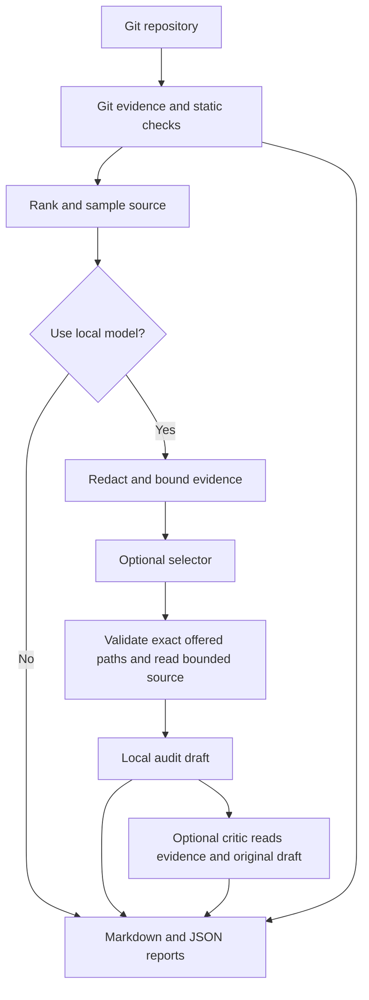

# Local LLM Code Auditor

[](https://github.com/lorenzobacci20/local-llm-code-auditor/actions/workflows/ci.yml)

Review a Git repository with a local Ollama model and inspect the evidence behind each conclusion. The CLI combines static checks, bounded source reads and an optional second pass that challenges a model’s draft. It writes a human-readable report and a versioned JSON record. The core runs on Python 3.11+ and Git with zero Python runtime dependencies.

### Quick start

From a clone of this repository, run the following in an activated virtual environment. On Windows create it with `py -3 -m venv .venv` and activate it with `.\.venv\Scripts\Activate.ps1`. On macOS or Linux use `python3 -m venv .venv` and `source .venv/bin/activate`.

```sh
python -m pip install .
python scripts/demo.py
```

The demo creates a temporary Git repository from the public sample and invokes the installed CLI. It checks three findings in the production configuration: detailed errors, a loopback endpoint and debug logging. The zero-quantity division in the pricing service illustrates the limits of those rules. Read the [example report](docs/example-report.md) or follow the [terminal walkthrough](docs/walkthrough.md).

To run the same fixture with Ollama, start a local server and choose a **locally installed** chat model from `ollama list`. Substitute its exact name for `MODEL`:

```sh
ollama list
python scripts/demo.py --llm --model MODEL --thinking auto
```

For another repository, copy `agent.example.toml` to `agent.toml`, then run:

```sh
local-llm-code-auditor --config agent.toml --repo /path/to/repo --no-llm
local-llm-code-auditor --config agent.toml --repo /path/to/repo --model MODEL --strict-pipeline
```

### What happens during a review



Git evidence and source sampling work across languages. Specialized rules inspect ASP.NET Core configuration and EF Core migration artifacts. Builds and test execution require an explicit `--run-build` on a trusted .NET repository. Python and Node.js receive source-level review. Their package scripts are never invoked automatically.

### Reproduce the evaluation

```sh
python scripts/evaluate.py --list
python scripts/evaluate.py --output evaluation-runs/static
```

Each case has a functional contract, expected behavior and an external rubric. The runner audits only a neutral fixture directory. Its deterministic checks, pipeline status and manual judgments answer different questions. The paired experiment preserves the draft a critic actually received. Sample size, missing evidence, partial replies and unjudged findings constrain the interpretation of any result. See [method and commands](docs/evaluation.md) and [benchmark results](docs/benchmarks.md).

All 22 deterministic cases completed. In one real local run, the selector found the missing invoice rule file, yet the audit and critic both missed its threshold defect. In another, the critic retained a valid division-by-zero finding and changed the verdict from GO to STOP. Both original responses are available for inspection.

### Operating boundaries

- Source reads and all three model prompts have size limits. Token estimates can differ from a model’s tokenizer. A sampled file may be clipped before inference.
- Pattern-based redaction removes recognized secrets before local inference. Operators remain responsible for data authorization, server configuration, report access and deletion. A local model may follow hostile instructions in a repository or make unsupported claims.
- The model has no shell, write, deployment or database tools. Opt-in .NET builds execute repository-controlled code with the operating-system privileges of the CLI process.
- JSON keeps deterministic findings separate from unverified model claims. A successful CLI exit describes execution and the implemented rules. Read the evidence before relying on the result.

### Project guide

| Topic | Where to start |
| --- | --- |
| Pipeline, budgets, reports and exit codes | [Architecture and report format](docs/architecture.md) |
| Local inference and supported configurations | [Model guide](docs/model-profiles.md) |
| Results, methodology and limitations | [Benchmarks](docs/benchmarks.md) · [Evaluation](docs/evaluation.md) |
| Security, privacy and reporting a vulnerability | [Security policy](SECURITY.md) |
| Terminal demo and engineering decisions | [Walkthrough](docs/walkthrough.md) · [Portfolio case study](docs/case-study.md) |
| Optional unattended execution | [Windows and macOS scheduling](docs/scheduling.md) |
| Release evidence and history | [Release candidate](docs/release-0.2.0.md) · [Validation](docs/validation.md) · [Changelog](CHANGELOG.md) |
| Development and planned work | [Contributing](CONTRIBUTING.md) · [Roadmap](docs/roadmap.md) |

Built by [Lorenzo Bacci](https://github.com/lorenzobacci20). The source and synthetic fixtures are distributed under the [MIT License](LICENSE). Git, Ollama, the optional .NET SDK and any separately installed weights have their own licenses.
