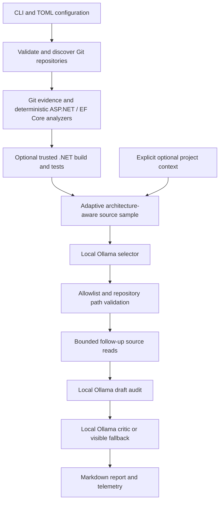

# Local LLM Code Auditor

[](https://github.com/lorenzobacci20/local-llm-code-auditor/actions/workflows/ci.yml)

**Evidence-first code review for Git repositories, powered by a local Ollama model.**

Build logs and passing tests cannot explain every defect. Sending an entire codebase
to an LLM is expensive, noisy and often inappropriate for private projects. This tool
collects deterministic evidence, selects a bounded sample of source files, and runs a
local selector → audit → critic pipeline to produce an inspectable Markdown report.

It is a working command-line tool with no Python runtime dependencies. Git evidence
and source sampling work across languages; the specialized deterministic analyzers
currently target **.NET, ASP.NET Core and EF Core**. It does not generate patches or
change source control.

## What is implemented

- Git repository validation/discovery, status, staged/unstaged diffs and recent commits.
- Architecture-aware source sampling: changed files first, then entry points, security,
  API, services, data and domain layers. Common vendor/generated trees are filtered.
- Adaptive source budgets based on the requested model context and existing evidence.
- An optional LLM selector that can request only allowlisted repository source paths.
- A draft audit and a separate critic pass, with explicit fallback/completion telemetry.
- ASP.NET configuration checks for malformed JSON, credential-like values, detailed
  production errors, loopback production endpoints and verbose production logging.
  JSON comments and trailing commas are supported; sensitive configuration values
  are omitted from deterministic findings.
- Static EF Core inventory and checks for duplicate migration IDs, missing snapshots,
  changed snapshots without changed migrations and unimplemented migration bodies.
  It never connects to a database or determines applied/pending migration state.
- Opt-in .NET builds and discovered test-project execution, with timeouts.
- Optional, bounded project context from an explicitly configured directory.
- Timestamped per-repository Markdown reports and optional scheduling examples.

## Stack and architecture

Python 3.11+, the standard library (`argparse`, `tomllib`, `dataclasses`, `urllib`, XML
and JSON), Git, and an optional local Ollama installation. pytest and Ruff are used
for development. The .NET SDK is needed only for `--run-build`.



`config.py` owns configuration; `git.py` and `process.py` collect command evidence;
`aspnet.py` / `efcore.py` implement deterministic rules; `source_review.py` and
`llm_review.py` constrain model input and follow-up selection; `ollama.py` owns the
local transport; `report.py` renders reports. `cli.py` coordinates the pipeline.

## Install and quick start

Install Python 3.11+ and Git. Run these commands from the cloned repository:

```sh
git clone https://github.com/lorenzobacci20/local-llm-code-auditor.git
cd local-llm-code-auditor
python3 -m venv .venv
source .venv/bin/activate
python -m pip install -e '.[dev]'
local-llm-code-auditor --help
python scripts/demo.py
```

On Windows use `python -m venv .venv`, then `.venv\Scripts\Activate.ps1` in PowerShell;
subsequent `python` and CLI commands are the same. You can also use the included
`scripts/install-macos.sh` or `scripts/install-windows.ps1` for a runtime-only install.

The demo needs **no model, API key, .NET SDK, database or external service**. It copies
`examples/synthetic-repo` into a temporary Git repository and runs the actual CLI.
It verifies three deterministic findings in deliberately unsafe synthetic production
configuration: `ASPNET_PROD_DETAILED_ERRORS`, `ASPNET_PROD_LOCALHOST` and
`ASPNET_PROD_VERBOSE_LOGGING`. It prints the real report and deletes the temporary
workspace. Keep a run for inspection with `python scripts/demo.py --output demo-workspace`
(the destination must not already exist). See [example output](docs/example-report.md).

For a real local-model run, install [Ollama](https://ollama.com/), start its local
server, download a model and run:

```sh
ollama pull qwen3.5:9b
python scripts/demo.py --llm --model qwen3.5:9b
cp agent.example.toml agent.toml
local-llm-code-auditor --config agent.toml --repo /path/to/your/repository
```

The optional demo explicitly disables thinking for the example model; use
`--thinking auto` for models without a thinking toggle. It uses the same synthetic
repository and intentionally leaves a
zero-quantity division defect for the model to inspect. Model findings can vary;
the deterministic demo assertions are reproducible. Model selection and memory
tradeoffs are documented in [model configuration](docs/model-profiles.md).

## CLI and configuration

```text
local-llm-code-auditor --config agent.toml --repo /path/to/repository --no-llm
local-llm-code-auditor --config agent.toml --repo /path/to/trusted/repository --run-build
local-llm-code-auditor --config agent.toml --model MODEL --num-ctx 16384 --num-predict 4096
local-llm-code-auditor --config agent.toml
```

`--repo` is repeatable. Without it, the CLI discovers repositories under configured
`roots`, excluding deployment/build-output directories. Relative roots, context paths
and `report_dir` resolve against the configuration file. **Builds/tests are disabled
by default**; `--run-build` enables them for repositories you trust. `--skip-build`
explicitly retains static-only mode. `--no-llm` still runs deterministic analyzers
and source selection; its report records that model review was skipped.

External context is disabled by default. To opt in, set `[context].enabled = true`
and an explicit `[context].path`. The context directory must contain `AGENTS.md`;
the loader reads that file and matching `projects/<repository>/` files named
`current-state.md`, `architecture.md`, `decisions.md`, and `README.md`, within a
character budget. No personal stores or neighbouring context repositories are
automatically discovered.

Reports are written to `reports/<repository>/YYYY-MM-DD_HHMMSS.md` by default.
They contain deterministic findings, selected-file names and coverage telemetry,
model completion/fallback status and the final analysis. Raw prompt/source text is
not embedded wholesale in reports. Reports **can still contain sensitive information**
from paths, metadata and model output: keep them private and review before sharing.
Repositories with the same directory name share a report folder; concurrent runs
within the same second can overwrite a report. Schedule runs sequentially.

Exit codes currently reflect deterministic/build/runtime status: `0` means no high
severity deterministic finding or execution failure, `1` means a high severity
finding, build/test failure or failed/incomplete audit-model request, and `2` means
invalid configuration/repository selection. **A zero exit code is not an LLM approval
or a security certification.** Read the model verdict and selector/critic telemetry;
a failed selector or critic can fall back while the CLI succeeds.

## Testing and verified scope

```sh
python -m pytest -q
python -m ruff check .
python -m ruff format --check .
python -m build
python scripts/demo.py
```

Tests use synthetic files and temporary Git repositories; no credentials or private
infrastructure are required. They cover repository discovery, deterministic .NET
execution decisions, ASP.NET/EF rules, source budgets/selection, follow-up allowlists,
reporting and privacy boundaries. Real LLM quality is not inferred from mocks.

[Validation evidence](docs/validation.md) records the commands and environment actually
checked for this release. CI defines Linux, macOS and Windows jobs with Python 3.11
and 3.13, plus a checksum-verified Gitleaks history/tree scan. Remote CI results must
be checked on the published commit; a workflow definition alone is not proof of a run.

## Security and limitations

- The client accepts only loopback HTTP(S) Ollama endpoints, disables environment
  proxies and refuses redirects. You must also configure Ollama for local-only use:
  a local server can still use a cloud-backed model. No cloud model is required.
- Source literals, diffs, commit messages, command output and explicitly enabled
  context are sent to that local model **without universal secret redaction**.
  Deterministic ASP.NET findings redact values; model instructions to omit secrets
  are not a confidentiality guarantee. Run only on data you are authorized to process.
- The model never supplies an executable command. Follow-up reads use a repository
  allowlist and path confinement. Source symlinks escaping the repository are rejected.
  These controls do not make this an OS sandbox or eliminate prompt injection.
- `--run-build` executes repository-controlled MSBuild targets and test code. Those
  targets may use the network, credentials or databases even though this tool does
  not issue database commands. Use a separate OS/container sandbox for untrusted code.
- Review is sampled and heuristic. It can miss defects or produce false positives;
  the critic does not prove correctness. Token budgets are estimates, not exact
  context-window guarantees. Unsupported stacks still get Git/source evidence but
  no specialized build/static rules.
- The tool does not push, merge, deploy, generate patches, execute migrations or
  connect to a database itself. Static EF evidence says nothing about live DB state.
- This is a local review assistant, not a replacement for expert security review,
  dependency scanning or required release checks.

See [SECURITY.md](SECURITY.md) for vulnerability reporting and [scheduling](docs/scheduling.md)
for optional Windows Task Scheduler / macOS launchd examples.

## Roadmap

- Evidence-wide secret redaction with explicit coverage and regression tests.
- Token-aware budgeting for selector inventory and critic input.
- Analyzer interfaces and Python/Node build/test analyzers.
- Structured findings and stable machine-readable exit semantics.
- Report comparison and collision-safe storage for repeated/concurrent runs.
- A published synthetic evaluation set for recall, false positives and critic behavior.

These are planned, not implemented features. No benchmark score or measured accuracy
improvement is claimed.

## Author and license

Built by [Lorenzo Bacci](https://github.com/lorenzobacci20). Licensed under the
[MIT License](LICENSE). Python runtime dependencies: **none**. Ollama, Git, .NET,
development tools and model weights are separate installations under their respective
licenses; no model weights or third-party source bundles are distributed here.
